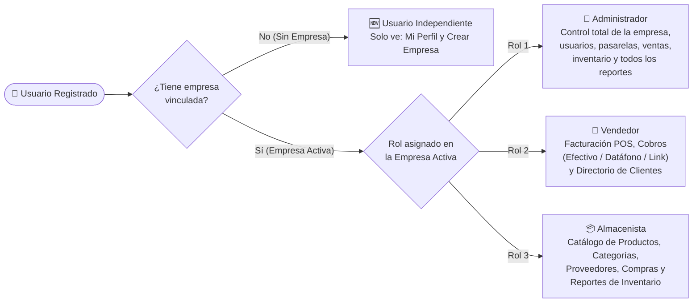
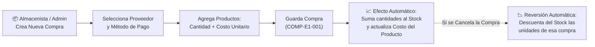
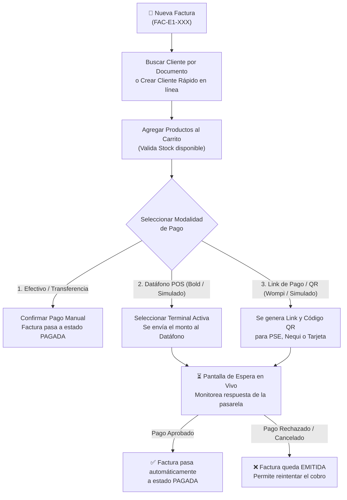

# Manual de Usuario — PymeSoft

> [!NOTE]
> **Guía Operativa Integral (Plataforma Web de Escritorio y App Móvil Android)**
> Este manual explica paso a paso cómo utilizar todos los módulos de **PymeSoft** según el rol asignado dentro de tu empresa (**Administrador**, **Vendedor**, **Almacenista** o **Usuario Independiente**).

---

## 1. Introducción y Plataformas Disponibles

**PymeSoft** es una plataforma integral diseñada para administrar las ventas, facturación en punto de venta (POS), cobros electrónicos con datáfono y código QR/Link, inventario, compras a proveedores, clientes y reportes gerenciales de múltiples empresas desde una sola cuenta.

Puedes acceder a PymeSoft desde dos interfaces sincronizadas en tiempo real:

| Plataforma | ¿Cómo acceder? | Características Principales |
| :--- | :--- | :--- |
| **💻 Aplicación Web de Escritorio (`PYMES_FE`)** | Desde cualquier navegador web (Chrome, Edge, Firefox) en el puerto `5001`. | Barra de navegación superior, tablas amplias de administración, selector rápido de empresa en la esquina superior derecha e impresión/vista detallada de facturas y reportes. |
| **📱 Aplicación Móvil / Híbrida (`pymesoft-movil`)** | Instalando el archivo **`pymesoft.apk`** en dispositivos Android o vía navegador en el puerto `8100` / `8080`. | Menú lateral deslizable (`☰`), actualización deslizando hacia abajo (*pull-to-refresh*), carga continua (*infinite scroll*) y **uso de la cámara nativa del celular** para tomar fotos de productos y foto de perfil. |

---

## 2. Perfiles de Usuario y Matriz de Acceso

En PymeSoft, un mismo usuario puede pertenecer a una o varias empresas y tener un rol específico en cada una:

### ¿Qué módulos puede usar cada rol?

| Módulo del Sistema | 👑 Administrador | 🛒 Vendedor | 📦 Almacenista | 🆕 Usuario Independiente |
| :--- | :---: | :---: | :---: | :---: |
| **Mi Perfil y Seguridad (`/perfil`)** | ✅ Completo | ✅ Completo | ✅ Completo | ✅ Completo |
| **Crear Nueva Empresa (`/empresas`)** | ✅ Completo | ✅ Completo | ✅ Completo | ✅ Completo *(pasa a ser Admin)* |
| **Editar Datos de la Empresa** | ✅ Completo | ❌ Sin acceso | ❌ Sin acceso | ❌ Sin acceso |
| **Gestión de Usuarios y Roles (`/usuarios`)** | ✅ Completo | ❌ Sin acceso | ❌ Sin acceso | ❌ Sin acceso |
| **Clientes (`/clientes`)** | ✅ Completo | ✅ Crear, Editar, Buscar | ❌ Sin acceso | ❌ Sin acceso |
| **Facturación POS y Cobros (`/facturas`)** | ✅ Completo | ✅ Emitir, Cobrar, Cancelar | ❌ Sin acceso | ❌ Sin acceso |
| **Conciliación de Pagos Electrónicos** | ✅ Exclusivo Admin | ❌ Sin acceso | ❌ Sin acceso | ❌ Sin acceso |
| **Terminales POS y Pasarelas (`/terminales`)** | ✅ Exclusivo Admin | 👀 Usa al cobrar | 👀 Usa en compras | ❌ Sin acceso |
| **Productos y Categorías (`/productos`)** | ✅ Completo | 👀 Consulta en POS | ✅ Crear, Editar, Ver | ❌ Sin acceso |
| **Proveedores (`/proveedores`)** | ✅ Completo | ❌ Sin acceso | ✅ Crear, Editar, Ver | ❌ Sin acceso |
| **Compras de Mercancía (`/compras`)** | ✅ Completo | ❌ Sin acceso | ✅ Registrar y Cancelar | ❌ Sin acceso |
| **Reportes de Ventas y Clientes** | ✅ Exclusivo Admin | ❌ Sin acceso | ❌ Sin acceso | ❌ Sin acceso |
| **Reportes de Inventario y Top Productos** | ✅ Completo | ❌ Sin acceso | ✅ Completo | ❌ Sin acceso |

---

## 3. Guía Paso a Paso por Módulo

### Módulo 1: Registro, Inicio de Sesión y Selección de Empresa

#### 1.1 Registro de Cuenta Nueva (`/auth/register` en Web | `/register` en Móvil)
1. En la pantalla de inicio de sesión, haz clic en **"Registrarse"** o **"Crear una cuenta"**.
2. Completa tus **Datos Personales**:
   - **Tipo de Documento**: Selecciona `CC`, `CE`, `NIT`, `TI` o `Pasaporte`.
   - **Número de Documento**: Ingresa tu identificación sin puntos ni espacios.
   - **Nombre y Apellido**: Al escribirlos, el sistema generará automáticamente tu **Nombre de Usuario (`username`)** con el formato `nombre.apellido` (verificando en tiempo real que esté disponible).
   - **Teléfono, Correo Electrónico, Dirección, Fecha de Nacimiento, Estado Civil y Número de Hijos**.
3. Completa tus **Datos Bancarios** (opcionales para nómina/reembolsos): `Banco`, `Tipo de Cuenta` (`Ahorros` / `Corriente`) y `Número de Cuenta`.
4. Define tu **Contraseña** (mínimo 6 caracteres) y pulsa **"Registrarme"**.

> [!TIP]
> **¿Qué ocurre después de registrarte?**
> Al registrarte por tu cuenta, ingresas inicialmente como **Usuario Independiente**. Desde ahí tienes dos caminos:
> 1. **Si eres el dueño del negocio**: Ve al módulo **Empresas → Nueva Empresa**, regístrala y el sistema te convertirá automáticamente en su **Administrador**.
> 2. **Si eres colaborador (Vendedor o Almacenista)**: Informa tu número de documento o `username` al Administrador de la empresa para que te vincule desde su módulo de **Usuarios**.

#### 1.2 Inicio de Sesión y Cambio de Empresa Activa
1. Ingresa tu **Usuario (`username`)** y **Contraseña** y pulsa **"Iniciar Sesión"**.
2. Si perteneces a varias empresas:
   - **En Web**: Usa el selector desplegable de empresa situado en la barra superior derecha junto a tu nombre.
   - **En App Móvil**: Selecciona la empresa al ingresar en la pantalla **"Seleccionar Empresa"** o cámbiala en cualquier momento desde el menú lateral (`☰` → **"Cambiar Empresa"**).

#### 1.3 Recuperación de Contraseña
1. En la pantalla de login, selecciona **"¿Olvidaste tu contraseña?"**.
2. **Paso 1 (Verificación de Identidad)**: Ingresa tu `Nombre de Usuario`, `Número de Documento` y `Correo Electrónico` registrados.
3. **Paso 2 (Nueva Contraseña)**: Una vez validada tu identidad, escribe y confirma tu nueva contraseña.

#### 1.4 Mi Perfil, Cámara de Avatar y Cierre de Sesión Global (`/auth/perfil` | `/perfil`)
1. Ingresa a **Mi Perfil** desde el menú superior (Web) o menú lateral (Móvil).
2. **Cambiar Foto de Perfil**:
   - En la **App Móvil**, toca el ícono de cámara sobre tu avatar y elige entre **Tomar Foto** con la cámara del celular o **Elegir de la Galería**.
   - En **Web**, selecciona un archivo de imagen desde tu computador.
3. **Cerrar Sesión en Todos los Dispositivos**: Si olvidaste tu sesión abierta en otro computador o celular, pulsa el botón rojo **"Cerrar sesión en todos los dispositivos"**. Esto invalidará inmediatamente cualquier sesión activa en otros equipos.

---

### Módulo 2: Panel de Control (Dashboard / Inicio)

Al iniciar sesión con una empresa activa, verás el **Panel Principal**:
- **Tarjetas de Indicadores Ejecutivos (KPIs para Administrador)**:
  - **Ventas del Mes (`$`)**: Suma total facturada en el mes en curso.
  - **Facturas Emitidas**: Cantidad de facturas registradas.
  - **Productos en Stock**: Total de referencias activas en catálogo.
  - **Clientes Activos**: Total de clientes registrados en la empresa.
- **Alerta de Stock Crítico**: Si existen productos con **5 unidades o menos (`stock <= 5`)**, aparecerá una alerta destacada para gestionar su reabastecimiento.
- **Accesos Rápidos**: Botones directos a los módulos permitidos para tu rol.

---

### Módulo 3: Gestión de Empresas (`Empresas`)

- **Ruta Web**: `/empresas` | **Ruta Móvil**: `/empresa`
1. **Crear una Nueva Empresa**:
   - Haz clic en **"Nueva Empresa"**.
   - Ingresa `Nombre o Razón Social`, `NIT` (único), `Dirección`, `Teléfono` y `Correo Electrónico`.
   - Haz clic en **"Guardar"**. Quedarás vinculado automáticamente como **Administrador** de la nueva empresa.
2. **Editar Empresa Actual** *(Solo Administradores)*:
   - Permite actualizar la dirección, teléfono, correo o estado (`Activo`/`Inactivo`) de la empresa seleccionada.

---

### Módulo 4: Administración de Usuarios y Roles (`Usuarios`)

- **Acceso**: Exclusivo para **Administrador (`Rol 1`)**.
- **Ruta Web**: `/usuarios` | **Ruta Móvil**: `/usuarios`

#### 4.1 Crear un Nuevo Colaborador desde Cero
1. Haz clic en **"Nuevo Usuario"**.
2. Diligencia los datos personales, documento, correo, contraseña inicial y selecciona el **Rol en la Empresa** (`Administrador`, `Vendedor` o `Almacenista`).
3. Al guardar, el colaborador quedará creado y vinculado automáticamente a tu empresa activa.

#### 4.2 Vincular un Usuario Existente o Cambiar su Rol en la Empresa
1. En el listado de usuarios, cambia el filtro de **"Vinculados a mi empresa"** a **"Todos"** y busca al usuario por su nombre, documento o `username`.
2. Entra a **"Editar"** (o toca la tarjeta del usuario en la App Móvil).
3. En la sección **Vinculación con la Empresa Activa**:
   - Cambia el **Estado en la Empresa** a **`Activo`** (para darle acceso) o **`Desvinculado`** (para retirarle el acceso a tu empresa sin borrar su cuenta personal).
   - Selecciona su **Rol en esta Empresa**: `Administrador`, `Vendedor` o `Almacenista`.
4. Pulsa **"Guardar Vinculación"**.

---

### Módulo 5: Productos, Categorías y Control de Inventario (`Productos`)

- **Acceso**: **Administrador** y **Almacenista**.
- **Ruta Web**: `/productos` y `/productos/categorias` | **Ruta Móvil**: `/productos` (pestañas *Productos* y *Categorías*).

#### 5.1 Crear Categorías
1. Dirígete a la sección **Categorías** y pulsa **"Nueva Categoría"**.
2. Escribe el nombre (ej. *Bebidas*, *Ferretería*, *Tecnología*, *Papelería*) y guarda.

#### 5.2 Registrar un Producto Nuevo
1. Haz clic en **"Nuevo Producto"**.
2. El sistema asignará automáticamente el código consecutivo de tu empresa (ej. `PROD-E1-001`).
3. Completa los campos:
   - **Nombre del Producto** y **Descripción**.
   - **Categoría** y **Proveedor Principal** (opcional).
   - **Unidad de Medida**: Selecciona entre `UND` (Unidad), `KG` (Kilogramo), `LB` (Libra), `LT` (Litro), `MT` (Metro), `CAJA` o `PAQ` (Paquete).
   - **Precio de Venta (`$`)**: Valor al público antes de IVA.
   - **Costo de Compra (`$`)**: Lo que cuesta adquirirlo al proveedor (si lo dejas vacío, el sistema calcula automáticamente el 70% del precio de venta como referencia inicial).
   - **Stock Inicial**: Cantidad física disponible actualmente en bodega.
   - **Fotografía del Producto**: En la App Móvil puedes pulsar **"Tomar Foto"** directamente al producto físico en estantería o cargarla desde galería.
4. Pulsa **"Guardar Producto"**.

#### 5.3 Interpretación de Semáforos de Stock
- 🟢 **Verde (`Stock > 5`)**: Disponibilidad normal.
- 🟡 **Amarillo / Naranja (`Stock entre 1 y 5`)**: ¡Alerta de Stock Bajo! Se recomienda generar una Orden de Compra.
- 🔴 **Rojo (`Stock = 0`)**: Producto Agotado (no permitirá vender unidades en Facturación hasta reabastecer).

---

### Módulo 6: Directorio de Proveedores (`Proveedores`)

- **Acceso**: **Administrador** y **Almacenista**.
- **Ruta Web**: `/proveedores` | **Ruta Móvil**: `/proveedores`
1. Haz clic en **"Nuevo Proveedor"** (código automático `PROV-E{empresa}-{consecutivo}`).
2. Ingresa el `NIT`, `Razón Social / Nombre`, `Nombre de la Persona de Contacto`, `Teléfono`, `Correo Electrónico`, `Dirección` y `Detalle de Productos o Servicios que suministra`.
3. Pulsa **"Guardar"**.

---

### Módulo 7: Órdenes de Compra y Entrada de Mercancía (`Compras`)

- **Acceso**: **Administrador** y **Almacenista**.
- **Ruta Web**: `/compras` | **Ruta Móvil**: `/compras`

1. Haz clic en **"Nueva Compra"**.
2. Selecciona el **Proveedor** y el **Método de Pago** (ej. *Efectivo*, *Transferencia*) junto con la referencia o número de factura del proveedor.
3. En la sección **Detalle de Productos**:
   - Selecciona el producto a reabastecer, ingresa la **Cantidad comprada** y el **Costo Unitario de compra**.
   - Haz clic en **"Agregar Producto a la Compra"** (puedes añadir múltiples líneas).
4. Indica si aplica **Descuento** o **IVA (19%)** y pulsa **"Registrar Compra"**.
5. **Efecto en Inventario**: El stock de todos los productos incluidos aumentará de inmediato. Si cometiste un error, puedes pulsar **"Cancelar Compra"** en el detalle y el sistema descontará automáticamente las unidades ingresadas.

---

### Módulo 8: Directorio de Clientes (`Clientes`)

- **Acceso**: **Administrador** y **Vendedor**.
- **Ruta Web**: `/clientes` | **Ruta Móvil**: `/clientes`
1. Haz clic en **"Nuevo Cliente"** (código automático `CLI-E{empresa}-{consecutivo}`).
2. Selecciona el `Tipo de Documento` (`CC`, `NIT`, `CE`, `TI`, `Pasaporte`), escribe el `Número de Documento`, `Nombre`, `Apellido`, `Teléfono`, `Correo` y `Dirección`.
3. **Actualización Inteligente**: Si ingresas un número de documento que ya estaba registrado en la empresa, PymeSoft actualizará sus datos de contacto sin generar duplicados.

---

### Módulo 9: Facturación POS y Cobros Electrónicos (`Facturas`)

- **Acceso**: **Administrador** y **Vendedor**.
- **Ruta Web**: `/facturas` | **Ruta Móvil**: `/facturas`

#### 9.1 Emitir una Nueva Factura
1. Entra a **Facturas → Nueva Factura**.
2. **Identificar al Cliente**:
   - Escribe el número de documento del cliente y pulsa **"Buscar"**. Si existe, sus datos se cargarán automáticamente.
   - Si es un cliente nuevo, simplemente llena sus datos ahí mismo y el sistema lo creará al emitir la factura.
3. **Agregar Productos al Carrito**:
   - Selecciona el producto (verás su precio y stock disponible), indica la **Cantidad** y pulsa **"Agregar"**.
   - Activa o desactiva el **IVA (19%)** o ingresa un **Descuento (`$`)** si aplica.
4. **Seleccionar el Método de Pago y Cobrar**:
   - **Opción A — Efectivo o Transferencia Manual**: Guarda la factura y márcala como **Pagada** ingresando opcionalmente el número de comprobante.
   - **Opción B — Cobro con Datáfono (`Bold` o `Datáfono Simulado`)**:
     1. Selecciona el método de pago de tipo datáfono y elige la **Terminal POS** (ej. `Caja Principal - SIM-E1-001` o tu datáfono Bold físico).
     2. Al confirmar, el monto viajará automáticamente a la pantalla del datáfono para que el cliente acerque o inserte su tarjeta.
   - **Opción C — Cobro con Link de Pago / Código QR (`Wompi` o `Pasarela Simulada`)**:
     1. Selecciona el método de pago por Pasarela / Link.
     2. El sistema mostrará en pantalla el **Código QR** y el **Enlace de Pago** para que el cliente pague desde su celular por **PSE, Nequi, Bancolombia o Tarjeta**.

> [!TIP]
> **Modo Entrenamiento / Sandbox Simulado**
> Cuando cobres usando un método configurado como **`Simulado`**, verás en la pantalla de cobro los botones **"Simular Aprobación"**, **"Simular Rechazo"** y **"Abrir Checkout Simulado"**. Esto te permite practicar todo el flujo de caja sin mover dinero real.

#### 9.2 Cancelar o Anular una Factura
- Desde el listado o detalle de una factura, pulsa **"Cancelar Factura"**.
- El estado cambiará a **`Cancelada`** y todas las unidades vendidas **regresarán automáticamente al stock de inventario**.

#### 9.3 Conciliación de Cobros Electrónicos *(Exclusivo Administrador)*
- Si alguna venta por datáfono o link quedó como `Emitida` (por ejemplo, si se cortó el internet mientras el cliente pagaba), el Administrador puede pulsar el botón **"Conciliar Cobros"** en el módulo de Facturas.
- El sistema consultará a Bold y Wompi todas las transacciones pendientes, marcará como **`Pagada`** las facturas que hayan sido aprobadas y expirará los intentos abandonados de más de 30 minutos.

---

### Módulo 10: Terminales POS y Pasarelas de Pago (`Terminales`)

- **Acceso**: Exclusivo para **Administrador (`Rol 1`)**.
- **Ruta Web**: `/terminales` | **Ruta Móvil**: `/terminales`
1. **Configurar Métodos de Pago y Pasarelas**:
   - Crea o edita métodos de pago (`Efectivo`, `Transferencia`, `Tarjeta`, `Pasarela`).
   - Elige el proveedor (`ninguna`, `wompi`, `bold` o `simulado`), el entorno (`sandbox` de pruebas o `produccion`) e ingresa tus llaves (`API Key Pública`, `API Key Privada`, `Secreto de Integridad` y `Secreto de Webhook`). Todas las llaves privadas se guardan cifradas.
2. **Vincular Datáfonos (Terminales POS)**:
   - Haz clic en **"Consultar Terminales Disponibles"** para detectar automáticamente los datáfonos asociados a tu cuenta Bold, o regístralos indicando `Nombre de Caja`, `Serial del Datáfono`, `Modelo` (ej. `N86`) y `Correo del Vendedor`.

---

### Módulo 11: Reportes e Inteligencia de Negocio (`Reportes`)

- **Ruta Web**: `/reportes` | **Ruta Móvil**: `/reportes`

| Reporte | Roles con Acceso | ¿Qué información entrega? |
| :--- | :---: | :--- |
| **📈 Reporte de Ventas** | 👑 Administrador | Ingresos totales, subtotal, IVA recaudado, descuentos otorgados y listado de facturas filtrable por **Fecha de Inicio** y **Fecha de Fin**. |
| **👥 Reporte de Clientes** | 👑 Administrador | Ranking de mejores clientes por monto total comprado, cantidad de facturas emitidas y ticket promedio. |
| **📦 Reporte de Inventario Valorizado** | 👑 Administrador 📦 Almacenista | Valor total del inventario al costo y al precio de venta, margen potencial de utilidad y listado de productos en **Stock Crítico (`<= 5`)** o agotados. |
| **🏆 Top Productos Más Vendidos** | 👑 Administrador 📦 Almacenista | Ranking de los productos con mayor rotación por unidades vendidas e ingresos generados. |

---

## 4. Preguntas Frecuentes (FAQ) y Solución de Problemas

| Pregunta / Situación | Cómo Resolverlo |
| :--- | :--- |
| **Me registré pero solo veo "Mi Perfil" y "Empresas", no veo Facturas ni Productos.** | Tu cuenta aún no está vinculada a ninguna empresa (**Usuario Independiente**). Crea tu propia empresa en el módulo **Empresas**, o pídele al Administrador de tu empresa que te busque en **Usuarios → Filtro: Todos** y te vincule como Activo. |
| **No me deja agregar un producto a una factura.** | Verifica en el módulo **Productos** que el artículo tenga **Stock mayor a 0** y que su estado sea **Activo**. Si está en 0, el Almacenista o Administrador debe registrar una **Compra** o ajustar el stock. |
| **Un cliente pagó por Link/QR pero la factura sigue como `Emitida`.** | Entra al detalle de cobro de la factura y pulsa **"Actualizar Estado"**, o pídele al Administrador que ejecute el botón **"Conciliar Cobros"**. |
| **¿Cómo cambio de empresa si trabajo en dos negocios distintos?** | En Web usa el selector de empresa en la barra superior derecha; en la App Móvil abre el menú lateral (`☰`) y toca **"Cambiar Empresa"**. |
