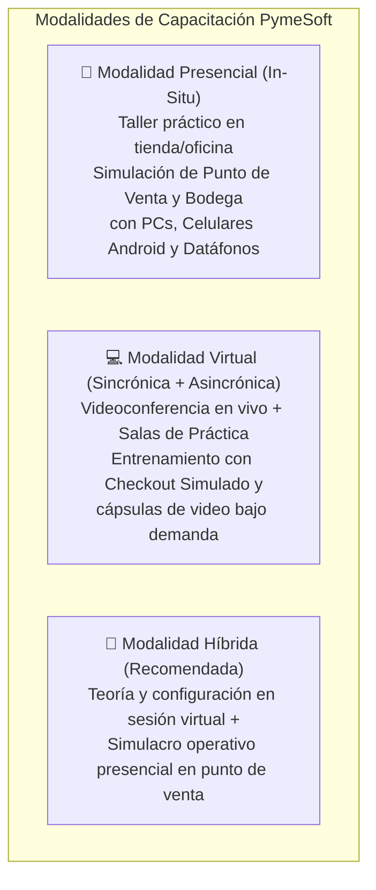
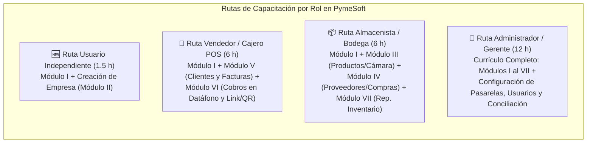

# Plan Integral de Capacitación — PymeSoft

> [!IMPORTANT]
> **Programa Oficial de Transferencia de Conocimiento y Adopción Operativa**
> Este documento establece la estrategia pedagógica, las modalidades de impartición (**Virtual y Presencial**), la malla curricular **por Módulos** y las rutas de entrenamiento especializadas **por Roles** (`Administrador`, `Vendedor`, `Almacenista` y `Usuario Independiente`) para la puesta en marcha de **PymeSoft** en versión Web y Aplicación Móvil Android.

---

## 1. Objetivos del Plan de Capacitación

- **Objetivo General**: Garantizar que el 100% del personal de la PYME domine las operaciones de **PymeSoft** (tanto en la aplicación Web de escritorio como en la aplicación móvil Android `pymesoft.apk`) de acuerdo con las responsabilidades y permisos de su rol, reduciendo errores operativos en facturación, cobros electrónicos e inventario.
- **Objetivos Específicos**:
  1. Aprovechar el **Motor de Pagos Simulado (`proveedor = 'simulado'`)** y la terminal virtual **`SIM-E1-001`** integrados en PymeSoft para que los participantes practiquen ventas reales, cobros por datáfono y links QR sin riesgo financiero antes de salir a producción.
  2. Capacitar a cada colaborador exclusivamente en los módulos que su perfil requiere, optimizando el tiempo de formación.
  3. Estandarizar los protocolos de **apertura de catálogo, abastecimiento por compras, facturación POS, cobro electrónico (Bold / Wompi) y conciliación de cierre de caja**.

---

## 2. Modalidades de Capacitación: Virtual y Presencial

PymeSoft cuenta con una ventaja técnica única para el entrenamiento: posee un **entorno Sandbox / Simulado nativo** tanto para **Datáfonos POS** como para **Links de Pago / QR**, además de funcionar en navegador web y en celulares Android. Esto permite impartir la capacitación en modalidad **Presencial**, **Virtual** o **Híbrida (*Blended*)**.

### 2.1 Modalidad Presencial (*In-Situ* / Laboratorio en Punto de Venta y Bodega)
Ideal para empresas con local comercial físico, bodega de almacenamiento o personal de caja concentrado en una misma sede.

| Componente | Especificación para Ejecución Presencial |
| :--- | :--- |
| **Metodología** | **"Aprender Haciendo" (*Learning by Doing*) y Juego de Roles Comercial**: Se recrea el flujo real de la empresa en vivo: el *Almacenista* toma fotos con su celular y carga una compra, el *Vendedor* factura desde el POS y cobra en datáfono/QR, y el *Administrador* audita y concilia el cierre. |
| **Infraestructura y Equipos Requeridos** | - **Red Wi-Fi Local (LAN)** conectando los equipos al servidor `PYMES_BE` (o entorno en la nube). - **1 Proyector o TV** para demostración guiada del instructor. - **Computadores de Caja / Administración** con navegador web apuntando a `PYMES_FE` (puerto `5001`). - **Teléfonos Android** de los participantes con la app **`pymesoft.apk`** instalada. - **Datáfono físico Bold** (en modo prueba) o terminal preconfigurada **`SIM-E1-001`**. |
| **Ventajas Clave** | Permite entrenar en terreno la toma de fotografías de productos en estantería con la cámara del celular, la verificación física de stock y la atención directa al cliente en mostrador. |

### 2.2 Modalidad Virtual (Sincrónica en Vivo y Asincrónica Autoguiada)
Ideal para equipos distribuidos en varias sucursales, emprendedores remotos o capacitación escalonada sin detener la operación del negocio.

| Sub-modalidad | Metodología y Herramientas |
| :--- | :--- |
| **🟢 Virtual Sincrónica (En Vivo)** | - **Plataforma**: Google Meet, Microsoft Teams o Zoom. - **Demostración Dual**: El instructor comparte pantalla mostrando simultáneamente la interfaz **Web (`PYMES_FE`)** y la vista **Móvil (`pymesoft-movil`)**. - **Laboratorio en Nube / Sandbox**: Cada participante ingresa con su usuario de prueba a una **"Empresa Escuela"** en PymeSoft y realiza los ejercicios guiados usando el portal interactivo `/api/webhooks/simulado/checkout` para simular pagos aprobados y rechazados. - **Salas por Rol (*Breakout Rooms*)**: División del grupo en salas separadas para Vendedores y Almacenistas durante los talleres prácticos. |
| **🔵 Virtual Asincrónica (Autoguiada 24/7)** | - **Cápsulas de Microlearning**: Videos cortos de 5 a 8 minutos por cada módulo funcional. - **Manual de Usuario Interactivo**: Consulta paso a paso del documento `MANUAL_DE_USUARIO.md`. - **Entorno de Práctica Libre**: Acceso permanente a una empresa de pruebas con productos semilla y pasarela simulada para practicar antes de la evaluación. |

### 2.3 Cuadro Comparativo para Elección de Modalidad

| Criterio | Modalidad Presencial | Modalidad Virtual | Modalidad Híbrida (Mixta) |
| :--- | :---: | :---: | :---: |
| **Duración por Sesión** | 2 a 3 horas | 1.5 a 2 horas (evita fatiga en pantalla) | 1.5h Virtual + 2h Taller Presencial |
| **Cupo Máximo Recomendado** | Hasta 15 personas por taller | Hasta 25 personas (con salas por rol) | Hasta 20 personas |
| **Práctica de Cámara Móvil e Inventario Físico** | ⭐⭐⭐⭐⭐ (Con mercancía real en bodega) | ⭐⭐⭐⭐ (Con objetos de prueba en casa/oficina) | ⭐⭐⭐⭐⭐ |
| **Práctica de Cobros (Datáfono / Link QR)** | Con datáfono físico Bold + Simulador | 100% con Simulador Integrado Bold/Wompi | Ambos (Simulador + Datáfono Físico) |

---

## 3. Plan de Capacitación por Módulos (Malla Curricular)

El contenido formativo de PymeSoft se organiza en **7 Módulos Académicos** que cubren de extremo a extremo los **11 módulos funcionales** del software:

### Módulo Formativo I: Fundamentos del Ecosistema, Acceso y Multi-Empresa
- **Módulos del Sistema Cubiertos**: `Autenticación (/auth)`, `Mi Perfil (/perfil)` y `Selección de Empresa (/seleccionar-empresa)`.
- **Duración**: 1 hora.
- **Dirigido a**: Todos los roles (`Administrador`, `Vendedor`, `Almacenista`, `Usuario Independiente`).
- **Temario**:
  1. Diferencias y ventajas entre la **Aplicación Web de Escritorio** y la **App Móvil Android (`pymesoft.apk`)**.
  2. Registro de usuario nuevo y generación automática del `username` (`nombre.apellido`).
  3. Inicio de sesión, selección de empresa activa y cómo cambiar entre múltiples empresas.
  4. Actualización de perfil, toma de fotografía de avatar con la cámara del celular y recuperación de contraseña en 2 pasos.
  5. Uso del botón de seguridad **"Cerrar sesión en todos los dispositivos"** (`/api/auth/logout-global`).
- **Ejercicio Práctico**: Registrarse en el sistema, subir foto de perfil desde el móvil, cambiar contraseña y probar el selector de empresa activa.

---

### Módulo Formativo II: Configuración de Empresa, Usuarios y Seguridad por Roles
- **Módulos del Sistema Cubiertos**: `Empresas (/empresas)` y `Usuarios y Vinculación (/usuarios)`.
- **Duración**: 1.5 horas.
- **Dirigido a**: `Administrador` (y `Usuario Independiente` para la creación de su primera empresa).
- **Temario**:
  1. Creación de una nueva empresa (NIT, Razón Social, Dirección, Contacto) y asignación automática del creador como Administrador.
  2. Creación de cuentas para colaboradores internos.
  3. Búsqueda de usuarios independientes registrados (`Filtro: Todos`) y vinculación a la empresa activa (`Activo` vs. `Desvinculado`).
  4. Asignación y cambio de rol por empresa: permisos exactos de `Administrador (1)`, `Vendedor (2)` y `Almacenista (3)`.
- **Ejercicio Práctico**: Crear una empresa de prueba, vincular a 1 Vendedor y a 1 Almacenista, y verificar qué opciones de menú ve cada uno al iniciar sesión.

---

### Módulo Formativo III: Gestión de Catálogo, Categorías y Control de Inventario
- **Módulos del Sistema Cubiertos**: `Categorías (/productos/categorias)` y `Productos (/productos)`.
- **Duración**: 2 horas.
- **Dirigido a**: `Administrador` y `Almacenista` (con nociones de consulta para `Vendedor`).
- **Temario**:
  1. Estructuración de categorías de productos.
  2. Creación y edición de productos con código consecutivo automático (`PROD-E{emp}-{num}`).
  3. Manejo de unidades de medida (`UND`, `KG`, `LB`, `LT`, `MT`, `CAJA`, `PAQ`), precio de venta y costo de compra (cálculo automático del 70% por defecto).
  4. **Captura fotográfica móvil**: uso de la cámara nativa en la App Android para fotografiar productos desde la bodega.
  5. Interpretación de alertas visuales de stock: Disponible (`> 5`), Stock Crítico (`1 a 5`) y Agotado (`0`).
- **Ejercicio Práctico**: Crear 3 categorías y registrar 5 productos desde la App Móvil tomando fotografías reales y configurando distintos niveles de stock inicial.

---

### Módulo Formativo IV: Directorio de Proveedores y Abastecimiento por Compras
- **Módulos del Sistema Cubiertos**: `Proveedores (/proveedores)` y `Compras (/compras)`.
- **Duración**: 2 horas.
- **Dirigido a**: `Administrador` y `Almacenista`.
- **Temario**:
  1. Registro y actualización de proveedores (`PROV-E{emp}-{num}`), NIT, persona de contacto y detalle de suministros.
  2. Creación de una Orden de Compra (`COMP-E{emp}-{num}`): selección de proveedor, método de pago y referencia de factura del proveedor.
  3. Adición de líneas de compra (cantidad y costo unitario), descuentos e IVA (19%).
  4. Verificación del **incremento automático de stock** y actualización del costo del producto al guardar la compra.
  5. Procedimiento de **Cancelación de Compra** y verificación de la reversión automática del inventario.
- **Ejercicio Práctico**: Registrar 2 proveedores, ingresar una compra de reabastecimiento para un producto que estaba en stock crítico (`<= 5`), verificar el nuevo stock y anular una compra de prueba.

---

### Módulo Formativo V: Gestión de Clientes (CRM) y Facturación en Punto de Venta (POS)
- **Módulos del Sistema Cubiertos**: `Clientes (/clientes)` y `Facturación Tradicional (/facturas)`.
- **Duración**: 2 horas.
- **Dirigido a**: `Administrador` y `Vendedor`.
- **Temario**:
  1. Administración del directorio de clientes (`CLI-E{emp}-{num}`), tipos de documento (`CC`, `NIT`, `CE`, `TI`, `Pasaporte`) y actualización inteligente sin duplicados (*upsert*).
  2. Emisión de Factura POS (`FAC-E{emp}-{num}`): búsqueda instantánea de cliente por documento o creación rápida de cliente nuevo sin salir de la factura.
  3. Adición de productos al carrito, validación en vivo contra el stock disponible, aplicación de descuentos e IVA (19%).
  4. Cobro en **Efectivo** o **Transferencia Manual** y confirmación de factura `Pagada`.
  5. Anulación/Cancelación de facturas y verificación del reintegro automático de las unidades al inventario.
- **Ejercicio Práctico**: Emitir 3 facturas (una a cliente existente, una creando cliente en línea y otra con descuento + IVA), y cancelar 1 factura verificando la devolución del stock.

---

### Módulo Formativo VI: Medios de Pago Electrónicos (Bold, Wompi, Simulado) y Conciliación
- **Módulos del Sistema Cubiertos**: `Terminales y Pasarelas (/terminales)`, `Cobros Electrónicos (/facturas/cobro)` y `Conciliación (/facturas/conciliar)`.
- **Duración**: 2.5 horas (1h operativa para Vendedores + 1.5h técnica/conciliación para Administradores).
- **Dirigido a**: `Administrador` (configuración + cobro + conciliación) y `Vendedor` (operación de cobro en caja).
- **Temario**:
  1. *(Solo Admin)* Configuración de métodos de pago y pasarelas (`Bold`, `Wompi`, `Simulado`), llaves cifradas y vinculación de datáfonos por serial/modelo.
  2. *(Admin y Vendedor)* **Flujo de Cobro por Datáfono POS**: envío automático del monto a la terminal (`SIM-E1-001` o Bold Smart POS), monitoreo de estado en vivo y manejo de rechazos.
  3. *(Admin y Vendedor)* **Flujo de Cobro por Link de Pago / Código QR (Wompi / Simulado)**: generación de link y QR en pantalla para pago con PSE, Nequi, Bancolombia o Tarjeta.
  4. *(Admin y Vendedor)* Entrenamiento con el **Portal de Checkout Simulado** (`Simular Aprobación`, `Simular Rechazo`).
  5. *(Solo Admin)* **Conciliación de Pagos Electrónicos**: uso de la herramienta **Conciliar Cobros** para sincronizar transacciones pendientes con las pasarelas y expirar intentos abandonados (`> 30 min`).
- **Ejercicio Práctico**: Realizar 1 venta cobrada por Datáfono Simulado (aprobada), 1 venta por Link/QR Simulado (rechazada y reintentada con éxito) y ejecutar una Conciliación General de Caja.

---

### Módulo Formativo VII: Analítica Empresarial, KPIs y Reportes Gerenciales
- **Módulos del Sistema Cubiertos**: `Dashboard Ejecutivo (/inicio)` y `Reportes (/reportes)`.
- **Duración**: 1.5 horas.
- **Dirigido a**: `Administrador` (los 4 reportes + KPIs) y `Almacenista` (Reportes de Inventario y Top Productos).
- **Temario**:
  1. Lectura del Dashboard Ejecutivo: Ventas del Mes, Facturas Emitidas, Productos en Stock, Clientes Activos y alertas de stock bajo.
  2. *(Solo Admin)* **Reporte de Ventas** por rango de fechas (`Fecha Inicio` / `Fecha Fin`): análisis de ingresos brutos, descuentos e IVA recaudado.
  3. *(Solo Admin)* **Reporte de Clientes**: identificación de clientes frecuentes y mayor facturación.
  4. *(Admin y Almacenista)* **Reporte de Inventario Valorizado**: costo total almacenado, valor comercial de venta, margen esperado y productos en punto de reorden.
  5. *(Admin y Almacenista)* **Reporte Top Productos Más Vendidos**: análisis de rotación para decisiones de compra.
- **Ejercicio Práctico**: Generar el corte de ventas de la sesión de entrenamiento, identificar el producto más vendido y calcular el valor total del inventario en bodega.

---

## 4. Plan de Capacitación por Roles (Rutas de Aprendizaje)

Para no sobrecargar al personal con funciones que no utilizarán en su día a día, la capacitación se imparte en **4 Rutas Formativas Especializadas por Rol**:

### 4.1 Ruta 1: Capacitación para el Rol `Administrador` (12 Horas — 6 Sesiones de 2h)
- **Perfil del Participante**: Dueño de la PYME, Gerente General, Administrador de Punto o Contador/Auditor.
- **Objetivo del Rol**: Configurar la empresa, administrar los accesos del personal, configurar pasarelas Bold/Wompi, supervisar el inventario y las ventas, conciliar pagos electrónicos y analizar la rentabilidad mediante reportes.

| Sesión | Módulos Incluidos | Enfoque Práctico del Administrador | Duración |
| :---: | :--- | :--- | :---: |
| **Sesión 1** | Módulos I y II | Registro, creación/edición de empresas, creación de usuarios, vinculación a la empresa activa y asignación de roles (`Admin`, `Vendedor`, `Almacenista`). | 2 horas |
| **Sesión 2** | Módulo III | Creación de categorías, parametrización de catálogo de productos, precios, costos, márgenes y control de alertas de stock bajo. | 2 horas |
| **Sesión 3** | Módulo IV | Gestión de proveedores, registro y auditoría de órdenes de compra e impacto en costos y existencias. | 2 horas |
| **Sesión 4** | Módulo V | Gestión integral de clientes (CRM), emisión de facturas POS, descuentos, IVA y autorización de anulaciones/cancelaciones. | 2 horas |
| **Sesión 5** | Módulo VI | Configuración de llaves de pasarelas (`Bold`, `Wompi`, `Simulado`), vinculación de terminales POS, pruebas de cobro y **Conciliación de Cobros Electrónicos**. | 2.5 horas |
| **Sesión 6** | Módulo VII | Análisis de KPIs del Dashboard, Reporte de Ventas por fechas, Reporte de Clientes, Inventario Valorizado y Top Productos. Evaluación final. | 1.5 horas |

---

### 4.2 Ruta 2: Capacitación para el Rol `Vendedor` (6 Horas — 3 Sesiones de 2h)
- **Perfil del Participante**: Cajero de punto de venta, Asesor Comercial de mostrador o Vendedor en ruta (con App Móvil Android).
- **Objetivo del Rol**: Atender rápidamente al comprador, registrar o buscar clientes por documento, facturar sin errores de stock y procesar cobros en efectivo, datáfono Bold o código QR/Link Wompi.

| Sesión | Módulos Incluidos | Enfoque Práctico del Vendedor | Duración |
| :---: | :--- | :--- | :---: |
| **Sesión 1** | Módulo I + Consulta Catálogo | Ingreso a Web y App Móvil Android, selección de empresa, gestión de su perfil y consulta rápida de precios y disponibilidad de productos. | 1.5 horas |
| **Sesión 2** | Módulo V | Búsqueda instantánea de clientes por documento (`CC`/`NIT`), creación rápida de clientes desde el POS, armado de carrito de venta, aplicación de IVA/descuentos y cancelación de facturas por devolución. | 2 horas |
| **Sesión 3** | Módulo VI *(Operativo)* | Cobro en Efectivo/Transferencia, envío de cobro a **Datáfono POS**, generación de **Link de Pago / Código QR** para PSE y Nequi, manejo de pagos rechazados y taller de velocidad en caja. | 2.5 horas |

---

### 4.3 Ruta 3: Capacitación para el Rol `Almacenista` (6 Horas — 3 Sesiones de 2h)
- **Perfil del Participante**: Jefe de Bodega, Auxiliar de Inventario, Encargado de Compras y Recepción de Mercancía.
- **Objetivo del Rol**: Mantener el catálogo de productos actualizado con fotografías reales, gestionar proveedores, registrar las entradas de mercancía mediante órdenes de compra y prevenir quiebres de stock usando los reportes de inventario.

| Sesión | Módulos Incluidos | Enfoque Práctico del Almacenista | Duración |
| :---: | :--- | :--- | :---: |
| **Sesión 1** | Módulo I + Módulo III | Uso de la **App Móvil Android** en bodega, creación de categorías, alta de productos, unidades de medida (`UND`, `KG`, `CAJA`, etc.) y **captura de fotos de productos con la cámara del celular**. | 2 horas |
| **Sesión 2** | Módulo IV | Alta y actualización de proveedores, registro de **Órdenes de Compra** al recibir mercancía, actualización de costos unitarios y reversión de compras erróneas. | 2 horas |
| **Sesión 3** | Módulo VII *(Inventario)* | Monitoreo de semáforos de stock crítico (`<= 5`), uso del **Reporte de Inventario Valorizado** y análisis del **Reporte Top Productos Más Vendidos** para planificar reabastecimientos. | 2 horas |

---

### 4.4 Ruta 4: Inducción Express para `Usuario Independiente` / Nuevo Emprendedor (1.5 Horas)
- **Perfil del Participante**: Emprendedor que acaba de descargar la app o registrarse en la web y aún no tiene empresa vinculada.
- **Contenido**:
  1. Autoregistro y verificación de `username` (15 min).
  2. Creación de su primera empresa en `/empresas/crear` y transición automática al rol **Administrador** (30 min).
  3. Configuración inicial en 3 pasos: crear su primera categoría, cargar sus primeros 3 productos y emitir su primera factura de prueba con cobro simulado (45 min).

---

## 5. Cronograma Sugerido de Implementación (Plan de 1 Semana)

Este cronograma permite capacitar y poner en producción a toda una PYME en **5 días hábiles** (aplicable tanto en modalidad Presencial como Virtual Sincrónica):

| Día | Jornada / Horario Sugerido | Grupo Convocado | Actividad y Módulos a Desarrollar |
| :---: | :--- | :--- | :--- |
| **Día 1 (Lunes)** | 2:00 PM – 4:00 PM (2h) | 👑 Todos los Roles (Plenaria) + Administradores | **Apertura + Módulos I y II**: Inducción general (1ra hora con todos los roles) + Configuración de empresa y vinculación de usuarios (2da hora solo Administradores). |
| **Día 2 (Martes)** | 2:00 PM – 4:00 PM (2h) | 👑 Administradores + 📦 Almacenistas | **Módulo III (Catálogo e Inventario)**: Creación de categorías, carga inicial de productos reales de la empresa y toma de fotografías desde la App Móvil. |
| **Día 3 (Miércoles)** | 2:00 PM – 4:00 PM (2h) | 👑 Administradores + 📦 Almacenistas | **Módulo IV (Proveedores y Compras)**: Carga del directorio de proveedores y registro de las primeras órdenes de compra para alimentar el stock. |
| **Día 4 (Jueves)** | 2:00 PM – 4:30 PM (2.5h) | 👑 Administradores + 🛒 Vendedores | **Módulos V y VI (Clientes, Facturación POS y Cobros Electrónicos)**: Práctica intensiva de caja con Efectivo, Datáfono Bold/Simulado y Link/QR Wompi/Simulado. |
| **Día 5 (Viernes)** | 2:00 PM – 4:00 PM (2h) | 👑 Administradores + 📦 Almacenistas + 🛒 Vendedores | **Módulo VII (Reportes) + Simulacro General en Vivo**: Juego de roles completo (Compra → Venta con Datáfono/QR → Conciliación → Corte de Reportes) y Evaluación Práctica. |

---

## 6. Evaluación Práctica y Certificación por Rol

Para aprobar la capacitación y recibir las credenciales del entorno de **Producción**, cada participante debe completar exitosamente la siguiente **Lista de Chequeo Práctica (*Checklist*)** dentro de la empresa de entrenamiento de PymeSoft:

### Checklist de Certificación — Rol `Vendedor`
- [ ] Inicia sesión en Web o App Móvil y verifica que se encuentra en la empresa correcta.
- [ ] Busca un cliente existente por número de documento desde la pantalla de **Nueva Factura**.
- [ ] Registra un cliente nuevo directamente durante una venta y emite una factura en **Efectivo**.
- [ ] Emite una factura y procesa un cobro por **Datáfono (Modo Simulado o Bold)** hasta que la factura cambie a estado **`Pagada`**.
- [ ] Emite una factura con **Link de Pago / QR**, simula un rechazo inicial, genera un nuevo intento de cobro y logra su aprobación.
- [ ] Cancela una factura emitida por error y comprueba que las unidades regresaron al stock.

### Checklist de Certificación — Rol `Almacenista`
- [ ] Crea una categoría nueva y registra un producto desde la **App Móvil Android** tomando su fotografía con la cámara.
- [ ] Registra un proveedor nuevo con su NIT y datos de contacto completos.
- [ ] Identifica un producto con **Stock Bajo (`<= 5`)** y registra una **Orden de Compra** que incremente sus existencias.
- [ ] Cancela una orden de compra mal digitada y verifica la resta automática del stock.
- [ ] Consulta el **Reporte de Inventario Valorizado** y el **Reporte Top Productos Más Vendidos**.

### Checklist de Certificación — Rol `Administrador`
- [ ] Crea o actualiza los datos fiscales de la empresa y vincula al menos un usuario como `Vendedor` y otro como `Almacenista`.
- [ ] Configura un método de pago de pasarela (`Bold` / `Wompi` / `Simulado`) y verifica una terminal POS activa en `/terminales`.
- [ ] Ejecuta el proceso de **Conciliación de Cobros** (`/facturas/conciliar`) y resuelve transacciones pendientes.
- [ ] Genera e interpreta los 4 reportes del sistema (**Ventas por rango de fechas**, **Clientes**, **Inventario** y **Top Productos**).
